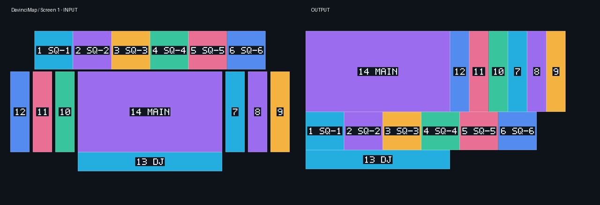
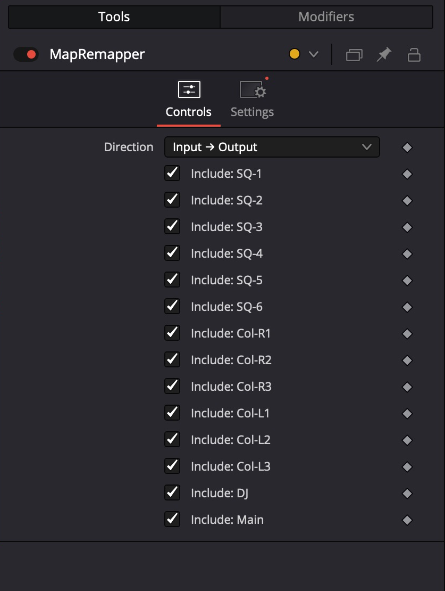
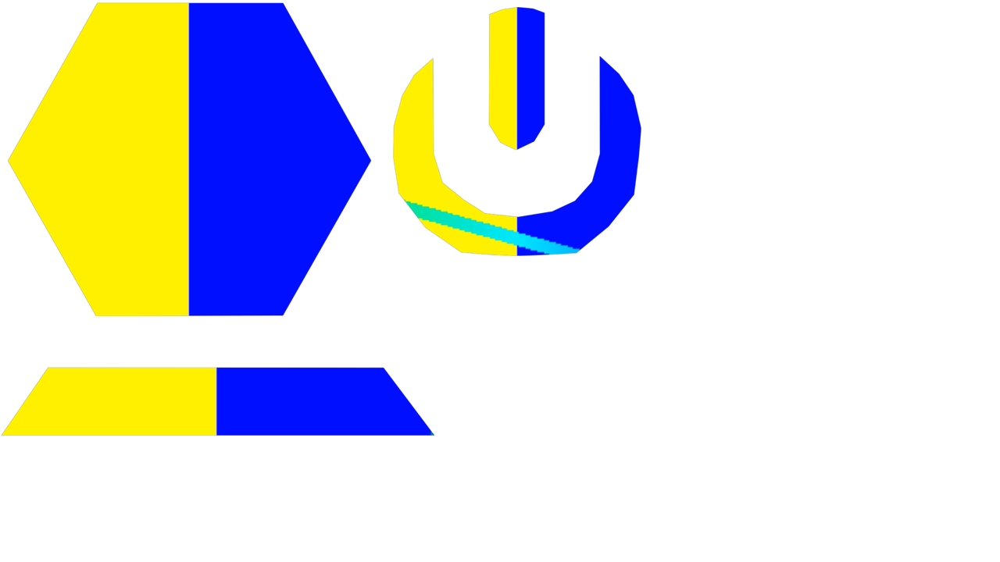

# Map Remapper user guide

**For DaVinci Resolve Studio on macOS**

Guide updated 29 October 2026. Screenshots show the current build in Resolve Studio 21.

Map Remapper converts a **complete frame already arranged on one map** into the other map. It can move content from the Resolume input layout into a selected output Screen's packing, or reverse that conversion.

Use [Slice Mapper](slice-mapper.md) first when you need to position and frame ordinary clips inside screens. Map Remapper preserves the content's relative position within each selected slice; it does not independently fit the whole clip into every slice.

## Contents

- [Understand the two directions](#understand-the-two-directions)
- [Install and open](#install-and-open)
- [Load the XML and choose an output Screen](#load-the-xml-and-choose-an-output-screen)
- [Confirm the output size](#confirm-the-output-size)
- [Choose slices and direction](#choose-slices-and-direction)
- [Apply immediately in Fusion](#apply-immediately-in-fusion)
- [Use the Inspector](#use-the-inspector)
- [Create an Edit effect](#create-an-edit-effect)
- [Work with both tools](#work-with-both-tools)
- [Render and share](#render-and-share)
- [Revise a map](#revise-a-map)
- [Supported geometry and limitations](#supported-geometry-and-limitations)
- [Troubleshooting](#troubleshooting)

## Understand the two directions

| Direction | Incoming frame | Rendered result |
| --- | --- | --- |
| Input → Output | Content laid out on the XML composition's input map. | The selected slices rearranged into one output Screen's coordinates. |
| Output → Input | Content laid out on the selected output Screen's map. | Those slices reconstructed in the composition's input coordinates. |



*Geometry preview: the input layout is on the left and the packed output layout on the right. These are layout diagrams, not video renders. Matching names and colours identify the corresponding slices.*

For example, DavinciMap's squares sit above Main in the input layout. In the output map, Main moves to the top left, the columns sit to its right, the squares are underneath and DJ is below them. The remapper performs that rearrangement for the pixels in each slice.

Each Resolume **output Screen has a separate coordinate space**. Two Screens can use the same pixel coordinates for different outputs. Choose one Screen per effect/render rather than combining those overlapping spaces.

## Install and open

1. Download [Map Remapper.lua](../../dist/Map%20Remapper.lua). On GitHub, open the file and use **Download raw file**.
2. In Finder, choose **Go > Go to Folder** and open:

   ```text
   ~/Library/Application Support/Blackmagic Design/DaVinci Resolve/Fusion/Scripts/Utility/
   ```

3. Create the folder if necessary, then copy `Map Remapper.lua` into it.
4. In Resolve, open **Workspace > Scripts > Map Remapper**.

The import utility uses `/usr/bin/python3` with Python 3.9 or newer and needs no third-party Python packages. Its backend is embedded in the Lua file. A different interpreter can be selected with the `DAVINCI_SLICE_PYTHON` environment variable inherited by Resolve.

## Load the XML and choose an output Screen

1. Click **Browse…**, select the Resolume Advanced Output XML, and load it. You can also paste its path and click **Load**.
2. Use **Output Screen** to choose the output whose packing you want to convert.
3. Compare the **INPUT MAP** and **OUTPUT MAP** previews.
4. Review unsupported entries in the slice list before applying the effect.

Both directions use the selected output Screen. Switching Direction does not mean selecting a different Screen.

For a show with CENTER, SR and SL outputs, create one remapper for CENTER, one for SR and one for SL. In the reverse direction, one instance reconstructs only the slices belonging to its selected Screen; other regions remain transparent.

## Confirm the output size

The input canvas size comes from the XML composition. The selected output Screen may have a different size.

- If a virtual output stores width and height, the utility reads them from the XML.
- Some capture-device presets omit their pixel dimensions. In that case, the utility proposes the composition size and displays a message asking you to confirm it.
- Enter the correct **Output size** width and height, then click **Refresh previews**.

Confirm the actual processor/output resolution rather than inferring it from the visible shapes. An incorrect size changes the canvas and the relationship between map coordinates and the rendered frame.

The supplied Ultra Melbourne CENTER, SR and SL bundles assume **3840 × 2160** outputs because the DeckLink XML does not store a pixel size. Confirm that assumption against your setup.

## Choose slices and direction

1. Include the required slices with their checkboxes. Coloured shapes are included; grey shapes are excluded.
2. Use **Previous / Next** to browse five slices per page. Selections persist across pages.
3. **Select all / Select none** affect the selected output Screen.
4. Choose **Initial direction**: Input → Output or Output → Input.
5. If building a reusable effect, enter a unique **Effect name**.

The previews show the layout and selection. Use the slice checkboxes for selection; this window does not provide Slice Mapper's click-to-select, zoom or pan controls.

The initial direction is the starting value for a newly created instance. You can change that instance's Direction later in the Inspector.

## Apply immediately in Fusion

1. Open the target clip on the **Fusion page**.
2. Ensure its incoming frame is laid out on the chosen source map, with content connected to a single MediaOut.
3. Open Map Remapper, load the XML, choose the output Screen, confirm its size, choose slices and set the initial direction.
4. Click **Add to Fusion**.
5. Select the new **MapRemapper** group and inspect the result.

```text
Completed frame in the source map -> MapRemapper -> MediaOut
```

The group is inserted before MediaOut and keeps the upstream graph. Use Fusion **Edit > Undo** to undo **Add Map Remapper**. A managed remapper immediately before MediaOut is detected to prevent accidental repeated insertion.

## Use the Inspector



*The example uses DavinciMap's Screen 1. The slice names shown in your instance come from its selected output Screen.*

| Control | Behaviour |
| --- | --- |
| Direction | Switch between Input → Output and Output → Input. |
| Include: slice name | Enable or disable that slice in the instance's output. |

These controls belong to the individual effect instance. Changing one clip does not change another. Turning all Include switches off produces transparency.

Direction changes the expected source coordinate space and the emitted destination canvas. Supply content in the corresponding source layout and review the timeline/render size whenever you change direction. It is a mapping-mode switch, not an animated spatial transition.

## Create an Edit effect

1. Prepare the map, Screen, size, selection and initial direction in the utility.
2. Enter a unique effect name.
3. Choose **Create & Install**, then **Install** in Resolve's template dialog. **Create Bundle** only saves the files.
4. Find the named effect under **Effects > Toolbox > Effects > Davinci Slice**.
5. Apply it to a clip containing a complete source-map frame.
6. Open **Inspector > Effects > Fusion > Controls** to change Direction or Include switches.

If the effect is absent, save the project and restart Resolve. Avoid installing both the loose `.setting` and the `.drfx`.

Files are saved in:

```text
~/Documents/DaVinci Slice/Remappers/<effect name>/
```

Each build contains a `.drfx`, `.setting` and `.remap.json` manifest. Existing names are refused; give a revised map a new name.

Ready-made examples are in [dist/Remappers](../../dist/Remappers/), with separate effects for DavinciMap Screen 1 and Ultra Melbourne CENTER, SR and SL.

## Work with both tools

### Author on the input map and render the output packing

1. Use Slice Mapper to frame clips on the XML input map.
2. Assemble the complete input-map frame, including all content layers.
3. Feed that completed frame into Map Remapper.
4. Select the required output Screen and choose **Input → Output**.
5. Render at that output Screen's dimensions.

```text
Source clips -> Slice Mapper instances -> Complete input-map frame
             -> Map Remapper Input → Output -> Output-map render
```

A Slice Mapper group can directly feed a remapper in the same Fusion graph. If the finished input frame comes from several timeline tracks, assemble those layers into a single frame before remapping. Applying the remapper to one underlying source clip only converts that clip's contribution.

### Author on the output map and render the input layout

1. Arrange the content directly against the selected output Screen's layout.
2. Feed that complete output-map frame into Map Remapper.
3. Choose the same Screen and **Output → Input**.
4. Render at the XML composition's input dimensions.



*Actual Resolve output for CENTER, including the concave U. The black preview background is transparent space outside the mapped shapes.*

## Render and share

| Direction | Timeline and render destination |
| --- | --- |
| Input → Output | The selected output Screen's width and height. |
| Output → Input | The XML composition's input width and height. |

1. Confirm the source frame uses the expected layout and dimensions.
2. Match the timeline/render dimensions to the destination.
3. Check the required Include switches.
4. Inspect a short test render at full resolution.
5. If transparency is required, use a format that supports alpha and enable alpha export.

With different canvas sizes, provide the correct source dimensions upstream in Fusion. The group emits the correct destination dimensions, but it cannot recover source pixels already removed by Resolve cropping or letterboxing. Avoid downstream clip transforms that move or scale the finished map unexpectedly.

Rendering uses native Fusion nodes. The XML, importer, Python helper and preview images are not required on render machines; normal source media is still needed. Share the `.drfx` for a reusable effect.

## Revise a map

Map Remapper embeds a snapshot of the XML geometry. Later XML edits do not automatically change existing instances.

To revise it:

1. Load the revised XML and review the Screen, size and slice selection.
2. Generate a new remapper under a new effect name, or apply a new group on a clean clip.
3. Check the source layout, destination dimensions and switches again.
4. Render a test before replacing the previous version in a delivery workflow.

**Slice Mapper's Update Map does not update Map Remapper.** This version has no equivalent animation-preserving remapper update operation.

## Supported geometry and limitations

Supported:

- Axis-aligned scale and translation between rectangles.
- Polygon contours whose output vertices follow the same mapping, including concave shapes.
- Linear and cubic Bézier slice masks, including inverted holes.
- Fractional coordinates, with up to 0.01 output pixels of tolerance for XML rounding.

Reported as unsupported:

- Perspective output warps.
- Deformed linear or Bézier output meshes.
- Individually moved polygon vertices that require a mesh remap.
- Rotated framing rectangles and output flips.

This is a geometric conversion. Screen/output colour adjustments, soft-edge blending, hardware routing and device latency are not reproduced.

Reverse mapping reconstructs the available regions. Overlaps, clipping and image resampling can lose information, so a round trip is not guaranteed to be lossless.

## Troubleshooting

| Symptom | Check or action |
| --- | --- |
| Output appears in the wrong arrangement | Confirm Direction and the layout of the incoming frame. |
| Shapes overlap unexpectedly | Check the output Screen. Different Screens use separate coordinate spaces. |
| Some input regions are empty in reverse | The instance reconstructs only its selected Screen and included slices. |
| Canvas dimensions are wrong | Confirm Output size, Direction and timeline/render dimensions. |
| XML has no output pixel size | Enter the actual output width and height and refresh the previews. |
| A slice cannot be selected | Read its reason; this version rejects unsupported warps instead of substituting their bounding rectangles. |
| Nothing renders | Enable an Include switch and verify the source connection and source-map content. |
| Add to Fusion asks for the Fusion page | Open the target clip in Fusion and retry. |
| A remapper is already connected | Use a clean clip or remove the previous remapper before inserting a replacement. |
| The XML changed on disk | Reload it and review the changed map. |
| Effect not visible in the library | Confirm installation, save and restart Resolve. |
| Installing a revised bundle did not update an old clip | Existing instances retain their embedded mapping. Create and apply a revised instance. |

**Verification:** the build has 57 automated tests and 10 native remapper render checks covering both directions, polygons, a circular mask, subset/empty selections and unequal canvas sizes. See the [render report](../../validation/remapper/render_report.json).

[Back to the project](../../README.md) · [Slice Mapper guide](slice-mapper.md)
