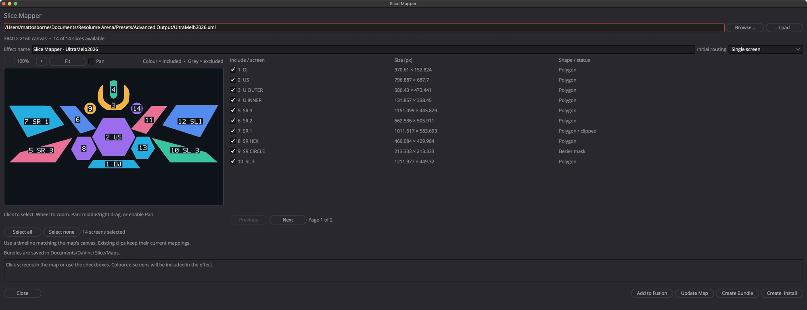
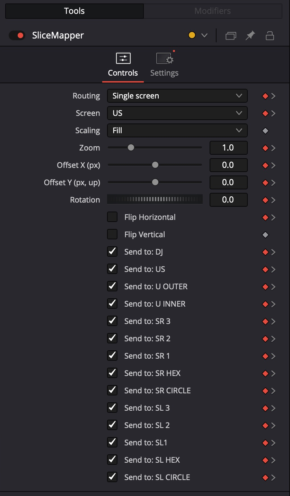
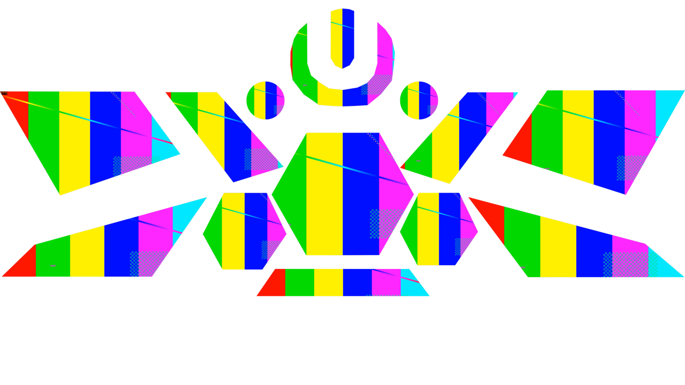
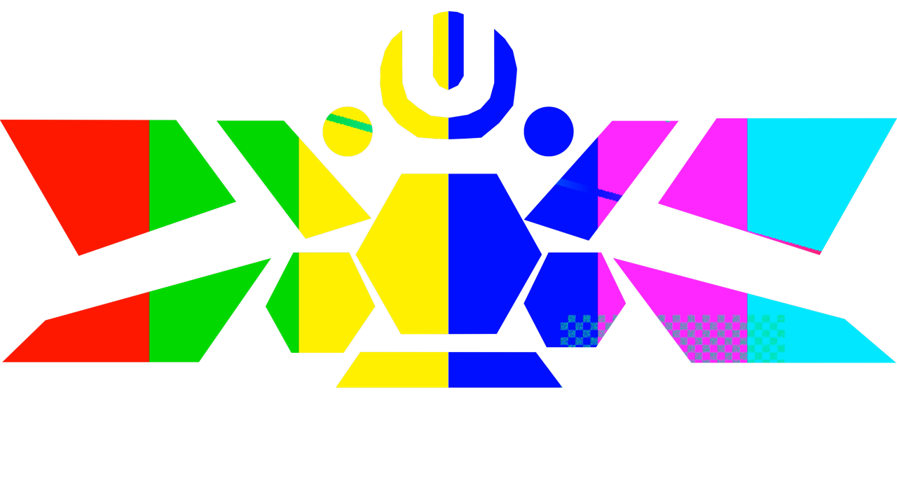

# Slice Mapper user guide

**For DaVinci Resolve Studio on macOS**

Guide updated 29 October 2026. Screenshots show the current build in Resolve Studio 21.

Slice Mapper places an ordinary video or image clip into the **input layout** of a Resolume Advanced Output map. Use it to frame one source inside one screen, repeat that source across several screens, or span one continuous image across the map.

To rearrange a completed frame between input and output layouts, use [Map Remapper](map-remapper.md).

## Contents

- [Install and open](#install-and-open)
- [Load a map and choose screens](#load-a-map-and-choose-screens)
- [Apply immediately in Fusion](#apply-immediately-in-fusion)
- [Choose the routing mode](#choose-the-routing-mode)
- [Frame the content](#frame-the-content)
- [Animate the controls](#animate-the-controls)
- [Update an existing map](#update-an-existing-map)
- [Create an Edit effect](#create-an-edit-effect)
- [Render and share](#render-and-share)
- [Troubleshooting](#troubleshooting)

## Install and open

1. Download [Slice Mapper.lua](../../dist/Slice%20Mapper.lua). On GitHub, open the file and use **Download raw file**.
2. In Finder, choose **Go > Go to Folder** and open:

   ```text
   ~/Library/Application Support/Blackmagic Design/DaVinci Resolve/Fusion/Scripts/Utility/
   ```

3. Create the folder if it does not exist, then copy `Slice Mapper.lua` into it.
4. In Resolve, open **Workspace > Scripts > Slice Mapper**.

The utility uses `/usr/bin/python3` with Python 3.9 or newer for importing XML. No third-party Python packages or Resolve Python scripting module are required. The installed Lua utility includes its own backend. An interpreter can also be selected through the `DAVINCI_SLICE_PYTHON` environment variable inherited by Resolve.

**Before mapping:** use a square-pixel timeline matching the XML composition size. The supplied DavinciMap and Ultra Melbourne examples use **3840 × 2160**. Start with a clean clip so an older mapper is not already changing the image.

## Load a map and choose screens

1. Click **Browse…**, choose the Resolume Advanced Output XML, and load it. You can also paste its path and click **Load**.
2. Check the canvas size and the number of available slices.
3. Click shapes in the preview, or use the screen checkboxes, to include or exclude them.
4. Choose **Initial routing**. This sets the starting mode for a new instance; each clip can change it later.
5. If creating a reusable effect, enter a unique **Effect name**.



*The Ultra Melbourne example contains polygons, a concave U and circular masks. The preview shows the XML input layout.*

Preview controls:

| Control | What it does |
| --- | --- |
| Coloured shape | Included in the generated mapper. |
| Grey shape | Excluded. |
| Click a shape | Toggle selection and open its list page. Empty gaps do not select anything. |
| Previous / Next | Browse ten list entries per page. Selections persist across pages. |
| Select all / Select none | Change the selection across the entire map. |
| + / − or mouse wheel | Zoom between 100% and 1600%. |
| Middle/right drag, or Pan plus left drag | Move around a zoomed preview. |
| Fit | Restore the complete centred view. |

Hover over a screen or status to inspect its name, position or reason it is unavailable. Overlapping shapes select the topmost drawn shape; use the list to select one underneath. Preview zoom and pan never change exported geometry.

## Apply immediately in Fusion

This is the quickest way to start working, without installing an effect bundle.

1. Open the target clip on the **Fusion page** and connect your source to **MediaOut**.
2. Open Slice Mapper, load the XML, select screens and choose the initial routing.
3. Click **Add to Fusion**.
4. Select the new **SliceMapper** group and open **Inspector > Controls**.
5. Choose a screen or multi-screen routing, then adjust framing.

The mapper is inserted before the composition's single MediaOut, preserving the upstream graph. Use **Edit > Undo** on the Fusion page to undo **Add Slice Mapper**. Repeated insertion immediately before MediaOut is detected; use **Update Map** to revise an existing managed mapper.

```text
MediaIn or your content graph -> SliceMapper -> MediaOut
```



*These controls belong to the selected clip's mapper. The red diamonds in this example indicate existing animation in the validation composition.*

## Choose the routing mode

| Routing | Result | Destination selection |
| --- | --- | --- |
| Single screen | Fit the source into one selected screen. | Use **Screen**. Send to checkboxes are ignored. |
| Repeat to checked screens | Fit a separate copy of the same source into every enabled destination. | Use **Send to:** checkboxes. |
| Span full map | Fit one continuous source across the full input canvas; enabled destinations reveal their corresponding regions. | Use **Send to:** checkboxes. |

**Repeat example**



**Span example**



*Both images are actual Resolve renders. Black areas in these previews represent transparent space outside the mapped screens.*

In Repeat, framing is evaluated in each screen's own rectangle. In Span, framing is evaluated against the full map canvas. Turning a destination off in Span does not reframe the others. With all Send to switches off, Repeat and Span output transparency.

One clip and one mapper can feed multiple screens. Use additional clips or tracks when the screens need independent content. Each instance has its own controls and animation.

## Frame the content

The screen boundary stays fixed while the source moves inside it.

| Control | Behaviour |
| --- | --- |
| Scaling — Fill | Preserve aspect ratio and crop enough to fill the screen. |
| Scaling — Fit | Show the whole source with preserved aspect ratio. Unused space is transparent. |
| Scaling — Stretch | Fit width and height independently, changing aspect ratio. |
| Zoom | Multiply the selected scaling. Start at **1**. |
| Offset X | Move content in screen pixels; positive moves right. |
| Offset Y | Move content in screen pixels; positive moves up. |
| Rotation | Rotate content inside the boundary. |
| Flip Horizontal / Vertical | Mirror content inside the boundary. |

Use these framing controls for placement. A later clip Video Transform can move the entire mapped result. Put effects such as blur or glow before the mapper if their expanded image must remain clipped inside the screens.

Polygons and circular masks clip the image after it is framed against the input rectangle. The effect does not bend content around individual polygon edges. Large offsets, rotation or zooming out can reveal transparent areas.

## Animate the controls

1. Select the mapper and locate the control in the Inspector.
2. Enable its keyframe diamond at the required frame.
3. Move the playhead and change the value.
4. Scrub the clip to check the result.

A Screen selector change jumps between destinations; it is not a spatial transition. Routing and Send to switches can also be animated. Changes affect that instance only.

## Update an existing map

**Update Map applies to native Fusion groups created with Add to Fusion.** It does not update arbitrary Edit Effects Library instances or Map Remapper effects.

1. Open the clip on the **Fusion page**.
2. Select its **SliceMapper** group. If there is only one managed mapper, it can be found automatically; with several, select exactly one.
3. Open Slice Mapper and load the revised XML.
4. Review the preview and choose which screen geometry should remain available.
5. Click **Update Map** and read the result message.
6. Scrub the clip. Use Fusion **Edit > Undo** to undo **Update Slice Mapper**, or Redo to restore it.

The published Screen, Scaling, Zoom, offsets, rotation, flips, Routing and Send to values retain their native animation curves. Screens match by Resolume ID first, then by unique name. Older groups without saved IDs are adopted by name on the first update.

- Reordered screens keep their existing selector slots.
- A renamed screen with the same ID stays in its original slot.
- Removed or excluded old screens appear as **Missing:** entries and render nothing.
- New screens are appended with **Send to off**. Enable them explicitly for Repeat or Span.
- Other clips and saved effect templates are unchanged.

The importer's selection decides which geometry is available. The instance's Send to switches decide which available destinations receive content. **Initial routing** does not override an existing clip during Update Map.

If the canvas size changes, update the timeline size and review framing. Pixel offsets retain their numerical values. Updating rebuilds internal geometry; manual edits inside the generated group are not preserved.

## Create an Edit effect

Use a bundle when you want a named effect in the Effects Library or want to share the effect with another machine.

1. Load the map, select screens, choose initial routing and enter a unique effect name.
2. Click **Create & Install**, then **Install** in Resolve's template dialog. **Create Bundle** saves files without opening the installer.
3. Find the effect under **Effects > Toolbox > Effects > Davinci Slice**. Search for its name if needed.
4. Drag it onto a clean clip.
5. Select the clip and open **Inspector > Effects > Fusion > Controls**.

If the effect is absent after installation, save the project and restart Resolve. Avoid installing both the loose `.setting` and the `.drfx`, which can create duplicate entries.

Files are saved in:

```text
~/Documents/DaVinci Slice/Maps/<effect name>/
```

The folder contains the installable `.drfx`, the Fusion `.setting` and a `.layout.json` manifest. Existing generated or installed names are refused. Use a new name such as `Show v2` for a revised reusable effect. Existing instances retain their embedded map; installing a revised bundle does not upgrade them.

## Render and share

1. Match the timeline and render dimensions to the input canvas.
2. Check the whole clip, including keyframes and screen changes.
3. Inspect the result at full resolution for clipping, missing destinations and unwanted transforms.
4. For transparency, choose an output format that supports alpha and enable alpha export. For example, a PNG sequence can retain transparency.
5. Render a short test before the full delivery.

A saved mapper instance renders with native Fusion nodes. Rendering does not require the original XML, importer, Python helper or preview image. Normal source media must still be available.

To share a reusable effect, send the `.drfx`. To convert its finished input-layout frame into packed output coordinates, feed that frame into [Map Remapper](map-remapper.md).

## Troubleshooting

| Symptom | Check or action |
| --- | --- |
| Add to Fusion asks for the Fusion page | Close or leave the utility, open the target clip in Fusion, then try again. |
| No suitable MediaOut | The direct workflow needs exactly one MediaOut with connected content. |
| A mapper is already present | Use Update Map for revised geometry, or use a clean clip for a separate mapper. |
| Empty output in Repeat or Span | Enable at least one Send to destination. |
| Send switches do nothing | In Single screen mode, use the Screen selector. |
| Content has moved outside the map | Check downstream transforms, including the clip's Video Transform. |
| A screen is unavailable | Hover over its status. Check enabled state, duplicate names and supported geometry. |
| The XML changed on disk | Click Load again and review the changed map. |
| A new screen does not render after an update | Enable its Send to switch, or select it in Single screen mode. |
| Update Map cannot find the effect | Select a managed group created by Add to Fusion. Edit-page effect instances are outside this update workflow. |
| Effect not visible in the library | Confirm the bundle installation, save and restart Resolve. |

**Scope:** Slice Mapper authors the Resolume input layout. It does not reproduce output packing, perspective/mesh warps, soft edges, output colour processing or live Resolume routing. It supports the documented rectangle, closed polygon and linear/cubic slice-mask geometry; unsupported geometry is reported during import.

[Back to the project](../../README.md) · [Map Remapper guide](map-remapper.md)
